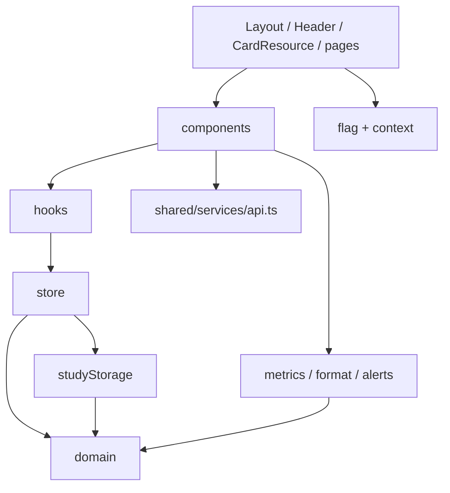
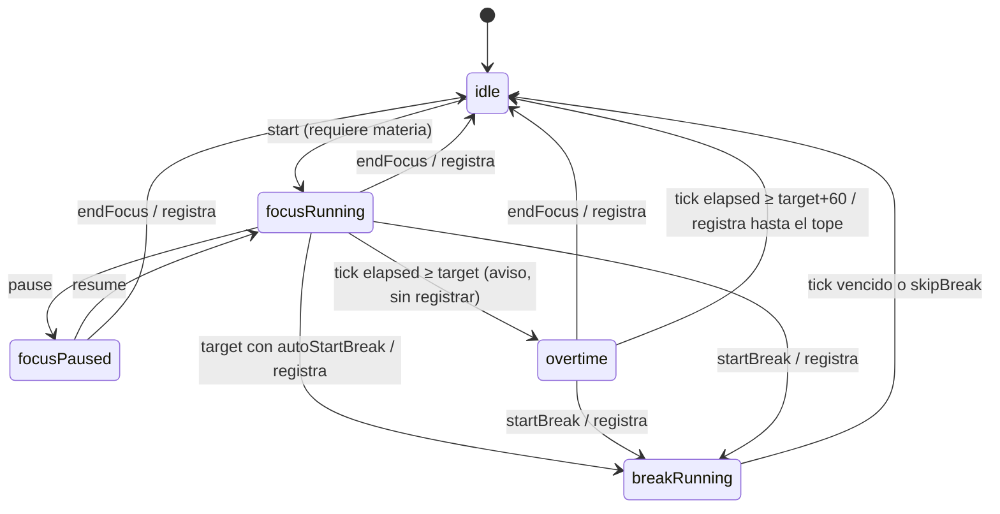

# Architecture Spine — Modo Estudio (fase 1)

Prototipo local, sin backend, detrás de un flag. El PRD es la fuente de verdad. Decisiones
tomadas sin el PO van con `[ASSUMPTION]`.

## Design Paradigm

**Functional core, imperative shell.**

| Capa | Directorio | Qué contiene | Puede depender de |
|---|---|---|---|
| Dominio (puro) | `src/features/study/domain/` | `timer.ts`, `sessions.ts`, `goals.ts`, `settings.ts`: tipos y funciones puras; `now` e ids se inyectan | nada del navegador ni de React |
| Persistencia | `src/features/study/utils/studyStorage.ts` | Lectura/escritura versionada en `localStorage`, parseo defensivo | dominio |
| Cálculo | `src/features/study/utils/metrics.ts`, `format.ts`, `alerts.ts` | Agregados para métricas, formato, sonido/notificación | dominio |
| Store (shell) | `src/features/study/store/studyStore.ts` | Singleton de módulo; única fuente de verdad en la página; sync entre pestañas | dominio, persistencia |
| Hooks | `src/features/study/hooks/` | `useStudy` (lectura), `useStudyEngine` (reloj), `useStudyAlerts` | store |
| UI | `src/features/study/components/` | Chip, panel, configuración, toast, métricas | hooks, `@/shared/services/api` (solo el picker) |
| Montaje | `Layout.astro`, `Header.astro`, `CardResource.tsx`, `pages/estudio.astro`, `pages/[id]/*.astro` | Gate del flag y contexto de página | `features/study/flag`, `features/study/context` |



## Invariants & Rules

### AD-1 — El timer se modela con marcas de tiempo y tiempo acumulado

- **Binds:** FR-6, FR-7, FR-9, NFR robustez
- **Prevents:** desfase en pestañas en segundo plano; dos fórmulas distintas de "minutos estudiados".
- **Rule:** el estado guardado nunca contiene un contador. Una fase corriendo guarda
  `runningSince` (epoch ms) y `accumulatedMs`; pausada, `runningSince = null`.
  `elapsed(now) = accumulatedMs + (runningSince ? now − runningSince : 0)`. Todo lo demás se
  deriva: `remaining = max(0, targetMs − elapsed)`, `overtime = max(0, elapsed − targetMs)`.
  Las pausas no suman porque no avanzan `elapsed`. Forma del estado (`TimerState`, unión
  discriminada por `phase`):

```ts
type StudySubject = { careerId: string; careerName: string; subjectId: string; subjectName: string };

type TimerState =
  | { phase: 'idle'; subject: StudySubject | null }
  | { phase: 'focus'; focusId: string; subject: StudySubject; startedAt: number;
      targetMs: number; runningSince: number | null; accumulatedMs: number; targetNotified: boolean }
  | { phase: 'break'; subject: StudySubject | null; startedAt: number; targetMs: number };
```

  El Descanso no se pausa (solo se salta), así que alcanza con `startedAt` + `targetMs`
  `[ASSUMPTION]`.

### AD-2 — Cuatro eventos, y solo cuatro, registran una Sesión de Estudio

- **Binds:** FR-7, FR-9, FR-10, FR-11
- **Prevents:** sesiones registradas desde la UI con reglas distintas a las del dominio.
- **Rule:** el dominio expone transiciones puras que devuelven `{ state, registered: StudySession | null }`.
  Registran exactamente: `endFocus` (manual), `startBreak` (desde Foco), `tick` al alcanzar
  `targetMs + 60 min` de `elapsed` (tope de Tiempo Extra) y `tick` al alcanzar `targetMs` con
  `autoStartBreak` activado (sin Tiempo Extra). Minutos registrados:
  - tope: `round((targetMs + 60 min) / 60 000)`;
  - arranque automático: `round(targetMs / 60 000)`;
  - manual / descanso: `round(elapsed / 60 000)`.
  Si el resultado es `< 1`, no se registra nada y la transición informa `registered: null` con
  motivo `too-short` `[ASSUMPTION]`. Ningún componente calcula minutos. No hay tope diario (el de
  12 h del spike se elimina).

### AD-3 — Regla de la pestaña cerrada: el tiempo nunca se reconstruye a mano

- **Binds:** FR-6, FR-9, FR-11
- **Prevents:** focos olvidados que acumulan horas; registros distintos según si la pestaña estaba
  abierta.
- **Rule:** al hidratar, el store ejecuta el mismo `tick(now)` que corre cada 250 ms. Un Foco
  corriendo cuyo `elapsed` superó el tope se registra con los minutos del tope y pasa a `idle`; un
  Descanso vencido pasa a `idle`. Un Foco **pausado** no vence nunca (no acumula). Un Foco
  corriendo dentro del tope sigue corriendo: cerrar la pestaña no pausa.

### AD-4 — La Sesión de Estudio tiene id de cliente estable y es la unidad de migración

- **Binds:** FR-6, FR-11, FR-12, FR-21, FR-23 (preparación)
- **Prevents:** duplicados entre pestañas y al migrar a la cuenta; edición que "agrega" tiempo.
- **Rule:** forma única:

```ts
type StudySession = {
  id: string;               // = focusId, crypto.randomUUID() al arrancar el Foco
  startedAt: string;        // ISO 8601 UTC; define día y semana (local) de acreditación
  endedAt: string;          // ISO 8601 UTC, informativo
  minutes: number;          // entero ≥ 1, editable
  recordedMinutes: number;  // entero, lo que registró el timer; tope de la edición
  endReason: 'manual' | 'break' | 'cap' | 'auto-break';
  careerId: string; careerName: string; subjectId: string; subjectName: string;
  updatedAt: string;        // ISO, para resolver conflictos en fase 2
};
```

  `appendSession` es idempotente por `id`. `editSession` acepta `1 ≤ minutes ≤ recordedMinutes`
  y cambio de materia/carrera (ids y nombres juntos); nunca cambia `startedAt`. `deleteSession`
  borra físicamente (sin tombstone en fase 1) `[ASSUMPTION]`. Una sesión se acredita al día y a la
  semana locales de `startedAt`.

### AD-5 — Metas con historial de vigencia por semana

- **Binds:** FR-13, FR-14, FR-15, FR-16
- **Prevents:** que cambiar una meta reescriba el pasado.
- **Rule:**

```ts
type GoalEntry = { from: string /* lunes YYYY-MM-DD local */; hours: number | null /* null = sin meta */ };
type StudyGoals = {
  weekly: GoalEntry[];
  bySubject: Record<string /* subjectId */, { subjectName: string; entries: GoalEntry[] }>;
};
```

  `goalFor(entries, weekStart)` = la última entrada con `from ≤ weekStart`. Definir, cambiar o
  quitar una meta escribe una entrada con `from = lunes de la semana en curso`, reemplazando la que
  ya tuviera ese mismo `from`. Mismo modelo para Meta Semanal y Meta por Materia `[ASSUMPTION]`.
  Semana: lunes 00:00 a domingo 23:59, hora local (`startOfWeek` del spike).

### AD-6 — Claves de almacenamiento versionadas; el formato del spike no se lee

- **Binds:** FR-21
- **Prevents:** que datos con forma vieja rompan el parseo; ambigüedad al migrar en fase 2.
- **Rule:** convención `exactamente:<name>:vN`. Toda lectura pasa por un parser defensivo que
  descarta lo inválido (patrón de `studyStorage.ts` del spike). Cambiar la forma = subir `N`.

| Clave | Forma | Nota |
|---|---|---|
| `exactamente:studyTimer:v2` | `TimerState` | v1 del spike tenía `endAt`/`cycle`/`mode` |
| `exactamente:studySessions:v2` | `{ version: 2, sessions: StudySession[] }` | v1 sin `recordedMinutes`/`endReason` |
| `exactamente:studySettings:v2` | `StudySettings` | v1 con descanso largo, esquina, etc. |
| `exactamente:studyGoals:v1` | `{ version: 1, ...StudyGoals }` | nuevo |
| `exactamente:studyLastCareer:v1` | `{ careerId, careerName }` | FR-3 sin Perfil |

  Las claves `…:v1` del spike no se migran: son datos de prueba del PO `[ASSUMPTION]`.
  `exactamente:studyOpen:v1` (sessionStorage) desaparece: el panel no persiste entre páginas.

```ts
type StudySettings = {
  focusMin: number;        // default 50, 5–120, presets 25/50/60
  breakMin: number;        // default 10, 1–30
  autoStartBreak: boolean; // default false
  sound: boolean;          // default true
  notify: boolean;         // default false
};
```

### AD-7 — Un único store por página; las pestañas se sincronizan por `storage` con escritura idempotente

- **Binds:** FR-4, FR-5, FR-6, FR-11
- **Prevents:** dos relojes con estados distintos en la misma página; sesiones duplicadas entre
  pestañas.
- **Rule:** `studyStore` es un singleton de módulo (las islas de Astro son árboles de React
  separados pero importan el mismo módulo ES) consumido con `useSyncExternalStore`. No se agrega
  librería de estado (regla del repo). Toda mutación es *read-latest → transición pura → write*:
  antes de transicionar, el store relee la clave de storage; si otra pestaña ya cambió la fase
  (otro `focusId` o `phase`), adopta lo guardado en lugar de transicionar. Las sesiones se escriben
  siempre releyendo la lista guardada y con `appendSession` idempotente por `id`, de modo que dos
  pestañas que registran a la vez producen una sola sesión. Otras pestañas reciben los cambios por
  el evento `storage` de las cinco claves. El toast de confirmación lo emite solo la pestaña cuya
  escritura agregó la sesión.

### AD-8 — Un solo motor de reloj por página, montado en el chip del header

- **Binds:** FR-4, FR-5, FR-6, FR-8
- **Prevents:** varios intervalos o alertas duplicadas en la misma página.
- **Rule:** `useStudyEngine` (intervalo de 250 ms mientras hay fase corriendo + `tick` en
  `visibilitychange` y al montar) y `useStudyAlerts` se montan **una sola vez**, en el chip del
  header (`placement="header"`), presente en todas las páginas con flag activo. El chip del Visor
  solo lee y despacha acciones. El aviso de fin de Foco se dispara cuando `tick` marca
  `targetNotified = true` (persistido), así que otra pestaña o una recarga no lo repiten.

### AD-9 — Un componente de chip, dos ubicaciones, una sola representación visible

- **Binds:** FR-4, FR-5
- **Prevents:** dos relojes visibles; panel del header abierto debajo del Visor.
- **Rule:** `StudyChip` recibe `placement: 'header' | 'viewer'`. `CardResource` (isla React)
  renderiza `<StudyChip placement="viewer" />` en la barra superior del Visor, a la izquierda de la
  X, y llama a `studyStore.setViewerOpen(true|false)` al abrir/cerrar. Con `viewerOpen`, el chip del
  header cierra su panel y no muestra toast; el del Visor los muestra dentro del diálogo
  (`z-[100]`). `viewerOpen` es estado de pestaña, no se persiste. El botón del spike
  (`StudyHeaderButton`, variantes desktop/menú) se reemplaza por este chip; el chip ya no vive en
  el menú mobile sino en la barra del header.

### AD-10 — El contexto de materia viaja como JSON en la página, no por props entre islas

- **Binds:** FR-1, FR-3, FR-5
- **Prevents:** prop drilling por `ResourcesView → ListOfResources → CardResource`; dos fuentes
  distintas de "materia de esta página".
- **Rule:** `Layout.astro` acepta una prop opcional `studyContext` y, si viene, renderiza
  `<script type="application/json" id="study-context">{ subjectId, subjectName, careers: [{careerId, careerName}] }</script>`.
  `/[id]/resumenes|parciales|finales.astro` la arman desde `subject` (ya resuelto en el servidor).
  `features/study/context.ts` expone `readPageContext()` (lee y memoiza el JSON). Al abrir el panel
  en `idle`, la Materia Activa se resuelve así: contexto de página → su materia; carrera = la
  última elegida si figura en `careers`, si no `careers[0]` (FR-3). Sin contexto: se mantiene la
  última Materia Activa. Con un Foco en curso, el contexto no cambia la materia.

### AD-11 — Feature flag `PUBLIC_STUDY_MODE`, apagado por defecto

- **Binds:** todo el Modo Estudio; PRD §6.1 (no se despliega a producción)
- **Prevents:** que un merge a `master` (producción en Vercel) exponga el prototipo.
- **Rule:** `features/study/flag.ts` exporta `isStudyModeEnabled = import.meta.env.PUBLIC_STUDY_MODE === 'true'`.
  Cualquier otro valor, o ausencia, = apagado. Se chequea en: `Layout.astro` (no emite
  `study-context` ni región live), `Header.astro` (no monta `StudyChip`), `CardResource.tsx` (no
  renderiza el chip ni llama al store), `pages/estudio.astro` (`export const prerender = false`;
  con flag apagado responde `404`). `.env.example` documenta `# PUBLIC_STUDY_MODE=true`. La
  variable no se define en Vercel. Test obligatorio: con flag apagado, Layout y Header renderizan
  sin ninguna isla del Modo Estudio.

### AD-12 — Toda llamada HTTP sigue pasando por `api.ts`

- **Binds:** FR-2, FR-3
- **Prevents:** `fetch` sueltos en componentes del Modo Estudio.
- **Rule:** el picker usa `getCareers` y `getSubjects({ careerId })` existentes. El dominio y el
  store no hacen HTTP. Fase 1 no agrega endpoints.

## Consistency Conventions

| Concern | Convention |
|---|---|
| Naming | Prefijo `Study` en componentes (`StudyChip`, `StudyPanel`, `StudySettings`, `StudyToast`, `StudyMetrics`). Términos del glosario en inglés en el código: Foco=`focus`, Descanso=`break`, Tiempo Extra=`overtime`, Racha=`streak`, Meta=`goal` |
| Ids | `crypto.randomUUID()` con fallback del spike (`randomId`) |
| Fechas | Persistidas en ISO UTC (`startedAt`, `endedAt`, `updatedAt`); agregación en hora local con `localDayKey` / `startOfWeek` |
| Minutos | Enteros. Formato visible con `formatMinutes` ("1 h 40 min") y `formatSignedDuration` ("+2 h 10 min", "−45 min") |
| Mutaciones | Solo vía métodos de `studyStore`; los componentes nunca escriben storage |
| Errores | Storage inaccesible = "nada guardado", nunca excepción (contrato de `readRaw/writeRaw`) |
| Tests | TDD (AGENTS.md del repo): dominio y métricas con Vitest directo, `now` inyectado; store con `createStudyStore({ now, newId })`; componentes con Testing Library; `.astro` con `// @vitest-environment node` |
| Estilos | Tailwind en el markup; gradientes de borde al 80 % (alpha `cc`) en `constants/styles.ts` |

## Stack

| Name | Version |
|---|---|
| Astro | ^5.11.0 (repo) |
| React | ^19.1.0 (repo) |
| @astrojs/react | ^4.3.0 (repo) |
| @astrojs/vercel | ^8.2.2 (repo) |
| Tailwind CSS | ^4.1.11 (repo) |
| Vitest | ^4.1.10 (repo) |

Sin dependencias nuevas.

## Structural Seed

```text
src/features/study/
  flag.ts                  # AD-11
  context.ts               # AD-10
  domain/
    timer.ts               # AD-1..AD-3 (reescrito)
    sessions.ts            # AD-4 (reworked)
    goals.ts               # AD-5 (nuevo)
    settings.ts            # AD-6 (reworked)
  utils/
    studyStorage.ts        # AD-6
    metrics.ts  format.ts  alerts.ts
  store/studyStore.ts      # AD-7
  hooks/useStudy.ts  useStudyEngine.ts  useStudyAlerts.ts
  components/
    StudyChip.tsx  StudyPanel.tsx  SubjectPicker.tsx  StudySettings.tsx  StudyToast.tsx
    metrics/StudyMetrics.tsx  metrics/MetricsCharts.tsx  metrics/SessionList.tsx
```



`overtime` no es una fase guardada: es `phase: 'focus'` con `elapsed ≥ targetMs`.

### Qué se conserva del spike

El spike (`juanpe44/modo-estudio`) no se mergea. La implementación arranca desde `master` y porta
lo que sirve, story por story.

| Archivo del spike | Decisión | Detalle |
|---|---|---|
| `domain/timer.ts` | **Reescribir** | Modelo `endAt`/`remainingMs`, ciclos y descanso largo no sirven (sin Tiempo Extra, acredita la duración planificada en vez de lo corrido, `reset` descarta el foco). Se conserva `StudySubject` y el estilo de funciones puras con `now`/`newId` inyectados |
| `domain/sessions.ts` | **Rehacer parcial** | Conservar `localDayKey`, `sessionDayKey`, `minutesOnDay`, dedupe por id. Eliminar `DAILY_CAP_MINUTES`. Agregar `recordedMinutes`, `endReason`, `editSession`, `deleteSession` |
| `domain/settings.ts` | **Rehacer parcial** | Conservar `normalizeSettings`/`clampSetting`. Campos según AD-6; sonido pasa a booleano; fuera `longBreakMin`, `cyclesBeforeLong`, `autoStartFocus`, `showTabTitle`, `corner` |
| `domain/goals.ts` | **Nuevo** | AD-5 |
| `utils/studyStorage.ts` | **Conservar patrón** | `readRaw`/`writeRaw` y parsers defensivos; claves v2, goals, lastCareer; fuera `readOpen`/`writeOpen` |
| `store/studyStore.ts` | **Conservar arquitectura, rehacer acciones** | Singleton + `useSyncExternalStore` + `storage` + CAS en tick + `onEvent`. Acciones nuevas: `start`, `pause`, `resume`, `endFocus`, `startBreak`, `skipBreak`, `setSubject`, `editSession`, `deleteSession`, `setWeeklyGoal`, `setSubjectGoal`, `setViewerOpen`. Fuera `setMode`, `reset`, `skip`, `open` |
| `hooks/useStudyTimer.ts` | **Conservar, adaptar** | Separar en `useStudy` (derivados: `remainingMs`, `overtimeMs`, `todayMinutes`, `weekMinutes`, `weeklyGoal`) y `useStudyEngine` |
| `hooks/useStudyAlerts.ts` + `utils/alerts.ts` | **Conservar, adaptar** | Disparo en `targetReached` (FR-8) y fin de Descanso; sonido booleano; fuera `studyTabTitle` y el mensaje del tope diario |
| `utils/metrics.ts` | **Conservar parcial** | Conservar `startOfWeek`, `weekMinutes`, `weekDays`, `minutesBySubject`, `streaks`, `heatmap`. Eliminar `MetricsRange`/`rangeStart`/`sessionsInRange`, `hourSlots`/`bestSlot`, `buildExport` |
| `utils/format.ts` | **Conservar** | Agregar `formatSignedDuration` y formato `+mm:ss` |
| `constants/styles.ts` | **Conservar, corregir** | Gradientes a 80 % de opacidad |
| `components/StudyHeaderButton.tsx` | **Reemplazar** | Por `StudyChip` (AD-9) |
| `components/StudyWidget.tsx`, `StudyPill.tsx` | **Eliminar** | No hay pastilla flotante; el motor pasa al chip del header (AD-8) |
| `components/StudyPanel.tsx` | **Rehacer** | Popover/sheet anclado al chip; sin selector de modo |
| `components/SubjectPicker.tsx` | **Conservar, adaptar** | Preselección por contexto + última carrera (AD-10) |
| `components/StudySettings.tsx` | **Rehacer** | Vista dentro del panel, guardado inmediato, campos de FR-20 |
| `components/StudyToast.tsx` | **Conservar, reubicar** | Anclado al chip visible |
| `components/ProgressRing.tsx` | **Eliminar** `[ASSUMPTION]` | El panel usa reloj grande + barra de meta |
| `components/metrics/*` | **Rehacer `StudyMetrics`, conservar charts** | `WeekChart`, `SubjectBars` (con meta), `Heatmap`, `MetricCard`; fuera `HourChart`. Nuevo `SessionList` |
| `Layout.astro`, `Header.astro`, `pages/estudio.astro` (cambios del spike) | **Rehacer** | Con gate del flag y sin `StudyWidget` |
| Tests `*.test.ts(x)` del spike | **Portar los que apliquen** | Como base de los tests nuevos; los de reglas eliminadas se descartan |

## Capability → Architecture Map

| Capability | Lives in | Governed by |
|---|---|---|
| FR-1 Materia por contexto | `context.ts`, `pages/[id]/*.astro`, `Layout.astro`, `SubjectPicker` | AD-10 |
| FR-2 Cambiar materia/carrera | `SubjectPicker`, `StudyPanel` | AD-12 |
| FR-3 Carrera preseleccionada | `studyStorage` (`lastCareer`), `context.ts` | AD-6, AD-10 |
| FR-4 Chip en el header | `StudyChip placement=header`, `Header.astro` | AD-8, AD-9, AD-11 |
| FR-5 Chip en el Visor | `StudyChip placement=viewer`, `CardResource.tsx` | AD-9 |
| FR-6 Sobrevive a la navegación | `domain/timer`, `studyStore`, `useStudyEngine` | AD-1, AD-3, AD-7, AD-8 |
| FR-7 Control del Foco | `domain/timer`, `StudyPanel` | AD-1, AD-2 |
| FR-8 Aviso de fin de Foco | `useStudyAlerts`, `alerts.ts`, `StudyChip` | AD-8 |
| FR-9 Tiempo Extra y tope | `domain/timer` | AD-1, AD-2, AD-3 |
| FR-10 Descanso a demanda | `domain/timer`, `settings` | AD-2 |
| FR-11 Registro | `domain/timer`, `domain/sessions`, `studyStore`, `StudyToast` | AD-2, AD-4, AD-7 |
| FR-12 Editar/borrar | `domain/sessions`, `SessionList` | AD-4 |
| FR-13/14 Metas | `domain/goals`, `StudyMetrics`, `StudyPanel` | AD-5 |
| FR-15–18 Métricas | `utils/metrics`, `StudyMetrics`, `MetricsCharts` | AD-4, AD-5 |
| FR-19 Estado vacío | `StudyMetrics` | — |
| FR-20 Preferencias | `domain/settings`, `StudySettings` | AD-6 |
| FR-21 Persistencia local | `studyStorage` | AD-6 |

## Deferred

- **Fase 2 (FR-22, FR-23):** endpoint de sesiones/metas y migración. Listo para ella: `id` estable
  = clave de idempotencia del POST; `updatedAt` para conflictos; ids reales de materia/carrera;
  metas con `from` por semana. Pendiente para el PRD de fase 2: tombstones de borrado si hay sync
  bidireccional, y qué pasa con la configuración (queda local).
- **Perfil (FR-3):** reemplazar `lastCareer` por la carrera del Perfil cuando exista el PRD de
  Roadmap de carrera.
- **Título de pestaña con el tiempo, export JSON, "mejor franja horaria", rangos mes/cuatrimestre:**
  backlog (no están en el PRD).
- **Web Locks / BroadcastChannel:** innecesarios mientras `appendSession` sea idempotente por id;
  revisar si aparece otro efecto no idempotente.
- **Despliegue:** ninguno. El prototipo se prueba en local con `PUBLIC_STUDY_MODE=true`; producción
  y previews quedan con el flag apagado.
